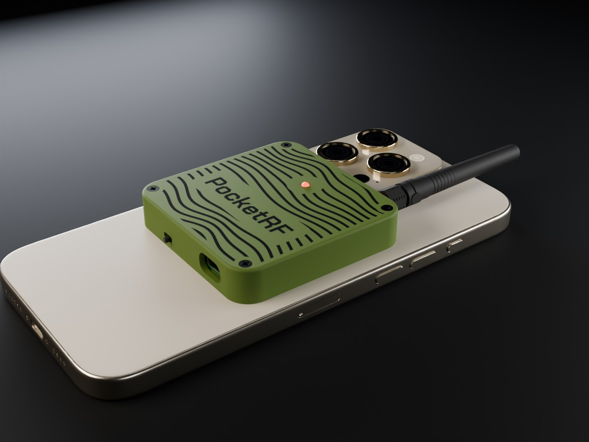

# Hardware: Parts, Wiring & Warnings

PocketRF is a two-chip build: a **Seeed Studio XIAO ESP32C3** (the brain, BLE radio) and a
**TI CC1101** Sub-GHz transceiver module (the RF front end). No display, no buttons.

Read the warnings at the bottom of this page before you power anything on. Two of them can
destroy your hardware, and one of them is a legal matter, not a technical one.

---

## Bill of materials

| # | Part | Notes | Typical source |
| :-: | :--- | :--- | :--- |
| 1 | **Seeed Studio XIAO ESP32C3** | The exact board the firmware targets. Other ESP32-C3 boards may work but the pin map and USB settings assume this one. | Seeed Studio, Mouser, Digi-Key |
| 2 | **CC1101 module, 3.3 V** | The common green/blue breakout with an SMA or u.FL connector. Must be the **3.3 V** variant — not 5 V. | AliExpress, Amazon, Adafruit (similar) |
| 3 | **Antenna for your band** | A 433 MHz module usually ships with a 433 MHz antenna. Using a 433 MHz antenna on 868 MHz (or vice versa) badly degrades range and can stress the PA. | Matches the module |
| 4 | **Dupont wires / small breadboard** | 6 signal wires plus power. Keep them short; long SPI leads hurt reliability. | Any |
| 5 | **Stable 3.3 V supply** | The XIAO's regulator can sag during full-power TX. A good USB cable or a dedicated 3.3 V supply is safer than a weak port or a small LiPo. | — |

Optional: an SMA pigtail if your module has u.FL, and a case. There is no official enclosure.

---

## Wiring (XIAO ESP32C3 → CC1101)

| XIAO pin | GPIO | CC1101 pin | Function |
| :--- | :--- | :--- | :--- |
| **D10** | GPIO 10 | SCK | SPI clock |
| **D2** | GPIO 4 | MISO | SPI MISO |
| **D3** | GPIO 5 | MOSI | SPI MOSI |
| **D5** | GPIO 7 | CSN | SPI chip select |
| **D1** | GPIO 3 | GDO0 | RX/TX data stream (RMT) |
| **3.3V** | 3.3 V | VCC | Power |
| **GND** | GND | GND | Ground |

Double-check **3.3 V vs 5 V** before connecting power. The CC1101 is a 3.3 V part and will not
survive 5 V on VCC or its I/O pins.

---

## Powering and flashing

The XIAO ESP32C3 exposes USB-C. Flash over USB; the firmware uses the native USB CDC stack
(`ARDUINO_USB_CDC_ON_BOOT=1`), so the serial monitor appears as a USB device rather than a UART
bridge. If uploads fail, put the board in bootloader mode (hold **BOOT**, tap **RESET**, release
**BOOT**) and retry.

---

## Case

The case is designed in **FreeCAD** and includes both a plain enclosure and a MagSafe/phone-mounted
variant. Source models, printable STLs, fonts, the dimensioned drawing, and reference renders are in
[`hardware/case/`](../hardware/case/README.md).

---

## ⚠️ Warnings

1. **Never transmit without an antenna attached.** A CC1101 transmitting into an open or mismatched
   load can be permanently damaged. Connect the antenna *before* you power on or send anything.
2. **Never power the CC1101 from 5 V.** VCC and all I/O are 3.3 V only.
3. **RF exposure.** Keep the antenna away from your body during sustained transmission and follow
   your country's exposure guidelines. This matters most for the jammer's full-power modes.
4. **Jamming is illegal.** See [LEGAL.md](../LEGAL.md). The 30-second cutoff is a safety limit, not a
   legal one.
5. **Duty cycle limits apply to normal operation too.** In the EU/UK, common 868 MHz allocations are
   capped at 1% (or 0.1%) duty cycle. Continuous replaying can breach that in minutes. See
   [LEGAL.md §2](../LEGAL.md#2-duty-cycle-and-band-rules).
